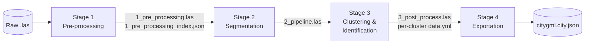

# Segmentor

**A Tool for Analyzing Point Cloud Data Using Vision Language Models**

Segmentor is a point cloud analysis tool that segments, clusters, and identifies
surfaces and objects in large LiDAR scans of real-world sites, such as indoor
parking garages or outdoor parking lots. It combines classical geometric
algorithms (RANSAC and DBSCAN) with open-weight Vision Language Models (VLMs).
It needs no task-specific training data and no model retraining.

> Research thesis, M.Sc. Embedded Systems Engineering,
> Fachhochschule Dortmund (University of Applied Sciences and Arts)
> **Author:** Mohammed Al-Salihi · **Supervisor:** Prof. Dr. Björn Schäfer · **Date:** 08.07.2026
>
> The full paper is included in this repository:
> [`Segmentor - Mohammed Al-Salihi.pdf`](./Segmentor%20-%20Mohammed%20Al-Salihi.pdf)

---

## Table of Contents

1. [Introduction](#1-introduction)
2. [Architecture](#2-architecture)
3. [Installation](#3-installation)
4. [Usage](#4-usage)
5. [Performance Report](#5-performance-report)
6. [Limitations and Future Work](#6-limitations-and-future-work)
7. [Citation](#7-citation)

---

## 1. Introduction

### The problem

LiDAR scanners can produce dense 3D point cloud data (PCD) for buildings,
parking garages, parks, and bridges. This data is used in autonomous driving,
urban planning, and city maintenance. Identifying and labeling the objects in
it is still difficult.

The usual approach is a supervised deep learning model. Such a model works well
on the objects and environments it was trained on, but its accuracy drops in a
new environment or on a new object category (for example, metal benches
instead of wooden ones). Each new domain then needs a new dataset and another
training cycle. These models are also black boxes, so an engineer cannot see
why a model gave a particular output.

### The approach

VLMs are pre-trained on large amounts of real-world images and are already good
at identifying objects in 2D pictures. Segmentor uses this to identify objects
in 3D data:

1. It uses **RANSAC** to find structural surfaces (ground, walls, ceilings).
2. It uses **DBSCAN** to group the remaining points into object clusters.
3. It renders each cluster from several angles, which turns its 3D geometry
   into a set of 2D images.
4. It sends those images to a VLM, either served locally through
   [Ollama](https://docs.ollama.com) or Claude through the Anthropic API, which
   names the object and explains in a short description what it saw. The description makes each answer traceable.
5. It converts the result into meshes and exports them in the
   **CityGML / CityJSON v2** standard.

For example, Segmentor turned a **30 GB** `.las` scan into a **20 MB** CityJSON
file that contains named, categorized surfaces and objects.

### Main contributions

- **A training-free hybrid pipeline** that combines classical segmentation
  algorithms with VLMs to identify objects and surfaces in large raw point
  clouds.
- **Multi-angle 2D projection** (the *Rich Media Tools*), which turns 3D
  clusters into orbit images so a standard VLM can reason about their geometry
  without native 3D support.
- **The Ball Neighborhood Surface Algorithm (BNSA)**, a custom greedy
  point-cloud-to-mesh algorithm that builds watertight meshes for both surfaces
  and complex objects. Its complexity can be controlled.
- **An evaluation methodology** for real-world indoor and outdoor scans. It
  identifies the factors that affect accuracy: VLM size, hardware, environment
  type, number of images, and whether RGB color is available.

---

## 2. Architecture

### 2.1 Four-stage pipeline

Segmentor is built as four sequential stages. Each stage reads the previous
stage's output file and writes a new one, so you can inspect every
intermediate result and re-run a stage with different parameters.



| Stage | Purpose | Key techniques | Output |
|---|---|---|---|
| **1. Pre-processing** | Turns a heavy, noisy raw scan into a compact, ordered form | Statistical outlier removal, voxel downsampling, sorting into spatial chunks with a KD tree | `1_pre_processing.las`, `1_pre_processing_index.json` |
| **2. Segmentation** | Classifies structural points chunk by chunk | Iterative RANSAC plane fitting with per-class rules (Z-histogram position, plane orientation, position relative to other planes) | `2_pipeline.las` (with `Classification`) |
| **3. Clustering & Identification** | Groups object points and identifies each group | DBSCAN clustering, multi-view rendering of the original full-resolution points, VLM query with JSON validation and up to 3 retries | `3_post_process.las` (with `Clustering`), a `data.yml` per cluster in `vlm_object_traces/` |
| **4. Exportation** | Converts points into meshes in a standard format | BNSA meshing inside an iterative complexity-reduction loop | `citygml.city.json` (CityJSON v2) |

Stage 1 is the only stage that loads the full point cloud into memory, and it
does not render it. Stages 2 to 4 read, preview, modify, and write data in
chunks, so a multi-gigabyte scan can be processed on a laptop with 8–32 GB of
RAM.

### 2.2 Point attributes

Segmentor writes two attributes into the `.las` files it produces, so the input
scan does not need any special attributes:

| Classification | Value | Meaning |
|---|---|---|
| `PCB_CLASSIFICATION_INIT` | 1 | Initial value for all points |
| `PCB_CLASSIFICATION_GROUND` | 2 | Ground surface |
| `PCB_CLASSIFICATION_WALL` | 3 | Wall surface |
| `PCB_CLASSIFICATION_CEILING` | 4 | Ceiling surface |
| `PCB_CLASSIFICATION_STRUCTURE` | 5 | Structure without a clear surface type |
| `PCB_CLASSIFICATION_OBJECTS` | 6 | Object without an identified category |
| `PCB_CLASSIFICATION_VEHICLE` (alias `..._CAR`) | 7 | VLM class `VEHICLE` |
| `PCB_CLASSIFICATION_OTHER_OBJECTS` | 8 | VLM class `OTHER` |
| `PCB_CLASSIFICATION_BUILDING` | 9 | VLM class `BUILDING` |
| `PCB_CLASSIFICATION_PERSON` | 10 | VLM class `PERSON` |
| `PCB_CLASSIFICATION_VEGETATION` | 11 | VLM class `VEGETATION` |
| `PCB_CLASSIFICATION_UNKNOWN` | 12 | VLM class `UNKNOWN` (values 7–254 are reserved for object categories) |

`Clustering` is an integer cluster ID per point. `0` means the point belongs to
no object, `1` is the first object cluster, `2` the second, and so on.

### 2.3 The pipeline algorithm (setup and process)

The segmentation stage separates *trying out* parameters from *applying* them:

- **Setup pipeline:** you tune each step (for example, ground segmentation
  with `ransac_iteration=10` and `allowed_angle=10`) on a preview chunk. When
  you confirm a step, Segmentor records its action name and parameters. Nothing
  is written yet.
- **Process pipeline:** Segmentor replays the recorded actions on every chunk
  of the file and then writes the output.

A confirmed pipeline is saved as `2_pipeline.yml`. You can replay it later
without the GUI (see [Headless runs](#headless-runs)).

### 2.4 Object identification (Rich Media Tools and VLM)

For each cluster, Segmentor computes the cluster's bounding box. It then loads
the **original, non-downsampled points with their RGB colors** inside that box,
because downsampled renders lose the detail a VLM needs. The camera orbits the
cluster's centroid at a fixed elevation of 35° and takes `N` evenly spaced
shots, starting at an azimuth of 225°:

$$
r = \max(\mathbf{b}_{max} - \mathbf{b}_{min}),\quad
\phi_i = \left(\phi_0 + (i-1)\tfrac{360}{N}\right) \bmod 360,\quad
\mathbf{e}_i = \mathbf{c} + (r_h\cos\phi_i,\; r_h\sin\phi_i,\; z_\delta)^\top
$$

The prompt tells the VLM:

- that the images are renders of a point cloud,
- what the scene context is (for example, a parking lot),
- to answer with strict JSON (`{"label": ..., "description": ...}`),
- the rules for rejecting walls, noise, and objects that do not make sense in
  the context.

If a response is invalid, Segmentor retries up to three times and then drops
the cluster.

### 2.5 Ball Neighborhood Surface Algorithm (BNSA)

CityGML stores meshes, not points. The meshing methods built into Open3D
(Alpha Shapes, Ball Pivoting, and Screened Poisson) each failed at least one of
these requirements:

- handle both surfaces and objects,
- let you control mesh complexity with a single parameter,
- produce watertight meshes.

BNSA meets all three. Starting from the lowest-Z seed point, it repeats these
steps until every point is used:

1. Collect the neighbors inside a ball of radius `r` around the current point.
   The point only expands the mesh if there are at least `m` neighbors.
2. Fit the local plane through those neighbors.
3. Take the convex hull of the outer points.
4. Triangulate the hull.
5. Continue from the boundary points that have not been used yet.

BNSA meshes can be heavier than needed. Segmentor therefore wraps BNSA in a
reduction loop: it re-samples the mesh into a new point cloud of at most 25% of
the input points and meshes it again. You set the number of iterations, for
example with `--ground-iterations`.

### 2.6 Software architecture (MVC)

The code follows a Model–View–Controller layout. It was designed for four
goals: **scalability**, **interactivity**, **separation of concerns**, and
**extensibility**.

```
segmentor/
├── main.py                      # GUI entry point: pre_process | pipeline | post_process
├── config.yml                   # Single configuration file for all stages
├── environment.yml              # Conda environment (Python 3.11)
├── modules/
│   ├── viewers/                 # VIEW: Open3D GUI windows and parameter layouts per stage
│   │   ├── pre_process/
│   │   ├── pipeline/input_layout/   # ground / wall / ceiling / objects segmentation panels
│   │   └── post_process/
│   ├── controllers/             # CONTROLLER: workflow, setup/process pipelines, previews
│   │   ├── pre_process/
│   │   ├── pipeline/
│   │   └── post_process/
│   ├── models/                  # MODEL: all I/O, math and algorithms
│   │   ├── las_tools/           # Chunked LAS read/write and iteration
│   │   ├── mesh_tools/          # BNSA implementation (ball_neighbourhood_mesh*.py)
│   │   ├── pcd_tools.py         # RANSAC segmentation, DBSCAN clustering
│   │   ├── pre_process_tools.py # Noise filter, downsampling, KD-tree indexing
│   │   ├── rich_media_tools.py  # Multi-view cluster rendering
│   │   ├── vlm_tools.py         # VLM prompt, retries and response validation
│   │   ├── vlm_providers/       # One backend per VLM (ollama_provider.py, claude_provider.py)
│   │   ├── cityjson_export.py   # CityJSON v2 writer
│   │   └── runtime_report.py    # Timing report (3_runtime_report.yml)
│   └── utils/                   # Config singleton, constants, logging
├── scripts/                     # Headless stage runners and tools
│   ├── pre_processing.py
│   ├── run_pipeline_from_file.py
│   ├── post_processing.py
│   ├── citygml_export.py        # Stage 4
│   └── result_validation.py     # Manual false-positive validation GUI
├── toolbox/                     # Helpers (restoring the original PCD, video rendering)
└── tests/                       # End-to-end tests with LAS fixtures
```

`vlm.provider` in `config.yml` selects the VLM backend (`ollama` or `claude`).
To add another backend, add a class with a `generate(prompt, images_b64) -> str`
method to `modules/models/vlm_providers/` and register it in
`get_vlm_provider()`. The prompt, retries and parsing stay shared in
`vlm_tools.py`.

**Tech stack:** Python 3.11 · NumPy · SciPy · Laspy · Open3D (processing,
visualization, GUI) · Ollama or the Anthropic SDK (VLM) · PyYAML · pytest.

---

## 3. Installation

### 3.1 Prerequisites

| Requirement | Notes |
|---|---|
| **OS** | Developed and evaluated on **Ubuntu 22.04 LTS**. The pinned `environment.yml` targets Linux x86-64. |
| **Conda** | [Miniconda or Anaconda](https://docs.conda.io/projects/conda/en/latest/user-guide/install/index.html) |
| **Ollama** *or* **Anthropic API key** | [Install Ollama](https://docs.ollama.com) to serve the VLM locally or on a remote host, or use Claude through the Anthropic API (see [3.3](#33-choose-a-vlm)) |
| **GPU** | Recommended for Stage 3. See the [hardware recommendations](#54-recommendations). |
| **Display** | Open3D GUI windows need a graphical session. X11 is recommended (see `run.sh`). |

### 3.2 Set up the environment

```bash
git clone https://github.com/M-Saeb/segmentor.git
cd segmentor

conda env create -f environment.yml
conda activate segmentor
```

### 3.3 Choose a VLM

**Option A: Ollama (local).** Pull a model:

```bash
# Light model, fits a laptop GPU with 8 GB of VRAM
ollama pull gemma3:4b

# Larger model with much higher accuracy (needs about 32 GB of VRAM)
ollama pull gemma3:27b
```

Make sure the Ollama server is running (`ollama serve`). Then set
`vlm.provider: ollama` and `vlm.ollama.model` / `vlm.ollama.host` in
`config.yml`.

**Option B: Claude (Anthropic API).** No GPU needed. Put your API key in the
environment (never in `config.yml`), then set `vlm.provider: claude`:

```bash
export ANTHROPIC_API_KEY=sk-ant-...      # Windows: set ANTHROPIC_API_KEY=sk-ant-...
```

Each cluster sends `views_count` images of 640×480 pixels, about 3–4k input
tokens at 8 views. `vlm.claude.model` defaults to `claude-opus-5-5`; use
`claude-sonnet-5-5` or `claude-haiku-5-5` for cheaper runs. A missing or wrong
key stops post-processing at the first cluster with an error.

### 3.4 Run the tests (optional)

```bash
PYTEST_DISABLE_PLUGIN_AUTOLOAD=1 python -m pytest
```

The end-to-end tests cover pre-processing, the RANSAC pipeline, and
post-processing (with a mocked VLM and without one), using the small LAS files
in `tests/fixtures/`.

---

## 4. Usage

### 4.1 Configure

All stages read one file, `config.yml`. At minimum, set the input scan and the
result folder:

```yaml
input_file: "/path/to/scan.las"          # the ORIGINAL raw scan (also used to restore full-resolution RGB in Stage 3)

result:
  output_folder_path: "/path/to/results"  # every stage reads its input from and writes its output to this folder
```

Commonly tuned parameters:

| Key | Type | Description |
|---|---|---|
| `chunk_size` | int | Points per chunk for chunked I/O |
| `filter_noise.nb_neighbors` / `std_ratio` | int / float | Statistical outlier removal |
| `downsample.voxel_size` | float | Point spacing after downsampling, in meters (`0.2` = 20 cm) |
| `ground_segmentation.method` | str | `ransac` (used in the paper), `csf`, or `basic` |
| `ground_segmentation.ransac_params.num_iterations` | int | RANSAC iterations for finding ground planes |
| `wall_segmentation.rotation_threshold` | float | How far a plane may tilt and still count as a wall |
| `ceiling_segmentation.facing_up_threshold` | float | Orientation tolerance for ceiling planes |
| `objects_segmentation.eps` / `min_points` | float / int | DBSCAN epsilon and minimum cluster size |
| `vlm.views_count` | int | Images rendered per cluster. **8 was the best value in the evaluation.** |
| `vlm.provider` | str | VLM backend: `ollama` (default) or `claude` |
| `vlm.ollama.model` | str | Ollama model tag, for example `gemma3:27b` (older configs with `vlm.model` still work) |
| `vlm.ollama.host` | str | Ollama endpoint, for example `http://localhost:11434` (older configs with `vlm.host` still work) |
| `vlm.claude.model` | str | Claude model ID, default `claude-opus-5-5` |
| `vlm.claude.effort` | str | `low` (default), `medium`, `high`, `xhigh` or `max`: how much Claude reasons before answering |
| `vlm.claude.max_tokens` | int | Output limit per request, including reasoning (default `4096`) |
| `vlm.claude.max_retries` / `timeout_seconds` | int / float | SDK retries for rate limits and server errors (default `2`), and request timeout (default `120`) |
| `vlm.claude.refusal_fallback` | bool | If Claude's safety filter declines a request, rerun it on another model (default `true`) |
| `collect_runtime_report` | bool | Write per-step timings to `3_runtime_report.yml` |

### 4.2 Interactive GUI workflow

`main.py` takes a mode and, optionally, a config path:

```bash
python main.py <mode> [config.yml]
```

Run the stages in this order:

```bash
# Stage 1: noise removal, downsampling, KD-tree chunking (no point rendering, to save RAM)
python main.py pre_process

# Stage 2: preview and confirm ground, ceiling, wall, and object segmentation per chunk, then process the whole file
python main.py pipeline

# Stage 3: VLM identification of each cluster
python main.py post_process

# Stage 4: build BNSA meshes and export CityJSON (shows a preview window of the result)
python scripts/citygml_export.py -c config.yml
```

`run.sh` is a helper for running on Linux desktops. It forces X11 for Open3D,
enables debug logging, and starts the default `pipeline` mode:

```bash
bash run.sh
```

### 4.3 Headless runs

You can run every stage without the GUI:

```bash
# Stage 1
python scripts/pre_processing.py

# Stage 2: replay a saved pipeline definition (for example, the 2_pipeline.yml written by the GUI)
python scripts/run_pipeline_from_file.py /path/to/results/2_pipeline.yml -c config.yml

# Stage 3
python scripts/post_processing.py -c config.yml [-i 2_pipeline.las] [-o 3_post_process.las]

# Stage 4
python scripts/citygml_export.py -c config.yml \
    --ground-iterations 2 --ceiling-iterations 2 --wall-iterations 1 --car-iterations 1
```

`scripts/pre_processing.py` sets its parameters in its `main()` function, not
on the command line.

### 4.4 Output files

All output goes to `result.output_folder_path`:

| File | Produced by | Contents |
|---|---|---|
| `1_pre_processing.las` | Stage 1 | Cleaned, downsampled, spatially sorted points |
| `1_pre_processing_index.json` | Stage 1 | Start and end index of each KD-tree chunk |
| `2_pipeline.yml` | Stage 2 | The confirmed pipeline (actions and parameters) |
| `2_pipeline.las` | Stage 2 | Points with structural `Classification` values |
| `3_post_process.las` | Stage 3 | Points with `Clustering` IDs and object classes |
| `vlm_object_traces/` | Stage 3 | Rendered views plus a `data.yml` (`CLUSTER_ID`, `CLASS`, `NAME`, `DESCRIPTION`, `EXTRA`) per cluster. With `objects_segmentation.create_unique_trace_dirs: true` each cluster gets its own `<cluster_id>/` subfolder; otherwise the files are overwritten by each cluster |
| `3_runtime_report.yml` | Stage 3 | Optional timing report |
| `citygml.city.json` | Stage 4 | CityJSON v2 meshes (for example, `groundSurface`, `wallSurface_N`, `carSurface_N`) |

You can view the `.las` outputs in tools such as
[CloudCompare](https://www.cloudcompare.org/).

### 4.5 Validating results

The evaluation measured false positives with a small GUI. It steps through every
cluster labeled as a vehicle, and you mark each one **Correct** or **Incorrect**:

```bash
python scripts/result_validation.py -i /path/to/results/3_post_process.las [-o validation.json]
```

---

## 5. Performance Report

The figures below summarize Chapter 5 of the paper. The evaluation measured
how well the VLM identifies **vehicles** (cars, vans, trucks, and
motorcycles). It did not separately benchmark the segmentation, clustering,
and meshing algorithms.

### 5.1 Setup

**Hardware**

| | Machine #1: laptop | Machine #2: workstation |
|---|---|---|
| CPU | Intel Core i7-13700HX | AMD Ryzen 9 9950X (16-core) |
| GPU | NVIDIA RTX 4070, 8 GB VRAM | NVIDIA RTX 5090, 32 GB VRAM |
| RAM | 32 GB | 186 GB |
| VLM | `gemma3:4b` | `gemma3:27b` |
| DBSCAN (eps / min points) | 0.45 / 15 | 0.35 / 10 |

**Test data:** three scans taken with a FJDynamics Trion S1 Pro handheld LiDAR
scanner.

| Area | Description | Points | Size | RGB | Vehicles |
|---|---|---|---|---|---|
| #1 | Underground parking lot (indoor) | 164 M | 10.8 GB | Yes | 17 |
| #2 | University outdoor parking lot (trees, benches, buildings with windows) | 143 M | 12.8 GB | Yes | 51 |
| #3 | Open parking floor of a clinic garage (ground and ceiling, no walls) | 260 M | 9 GB | No | 59 |

**Method:** the vehicles in each scan were labeled by hand to create the
ground truth. Each scenario was run 3 times and the results were averaged.

- **Accuracy** is the share of ground-truth vehicles that the VLM labeled as a
  vehicle.
- **False positive rate** is the share of vehicle-labeled clusters that are
  not vehicles.

### 5.2 Results

| Machine | Area | Discovered / Total | **Accuracy** | **False positives** | Detected objects | **Duration** |
|---|---|---|---|---|---|---|
| #1 (`gemma3:4b`) | #1 | 14 / 17 | 82% | 1% | 50 | 00:08:30 |
| #1 (`gemma3:4b`) | #2 | 36 / 51 | 71% | 2% | 322 | 02:25:11 |
| #1 (`gemma3:4b`) | #3 | 23 / 59 | 39% | 0.2% | 97 | 00:30:00 |
| #2 (`gemma3:27b`) | #1 | 15 / 17 | 88% | 2.9% | 68 | 00:04:10 |
| #2 (`gemma3:27b`) | #2 | 44 / 51 | 86% | 4% | 389 | 00:20:30 |
| #2 (`gemma3:27b`) | #3 | 54 / 59 | **92%** | 0.55% | 87 | 00:05:00 |

| | Machine #1 (`gemma3:4b`) | Machine #2 (`gemma3:27b`) |
|---|---|---|
| **Average accuracy** | 64% | **88.6%** |
| **Average run time** | ~61 min | **~10 min** |
| **False positive range** | 0.2% – 2% | 0.55% – 4% |

### 5.3 Key findings

- **Model size matters most.** The 27B model was 24.6 percentage points more
  accurate on average than the 4B model. It was also about 6× faster, because
  it ran on stronger hardware.
- **False positives stay low on both machines (≤ 4%).** The paper found no
  direct relationship between accuracy and false positive rate.
- **Eight images per object worked best.** Accuracy rose from 2 to 8 views and
  dropped slightly at 12 views. Run time grows directly with the number of
  views.
- **Indoor scans were more accurate than outdoor scans.** Outdoor scans were
  noisier and more varied, and Area #2 had the highest false positive rate.
- **Color helps small models.** Without RGB (Area #3), `gemma3:4b` fell to 39%,
  while `gemma3:27b` with 8 or more views reached 92%.
- **Distance and windows reduce accuracy.** Cars far from the scanner path were
  often missed. Rooms seen through windows were sometimes labeled as vans.
- **VLMs sometimes ignore the context.** Labels such as *cake*, *plane*, or
  *saxophone* came back despite the parking lot context in the prompt, which
  is why responses must be validated.
- **Thinking models are slow.** `qwen3-vl:8b` took at least twice as long as
  `gemma3:4b` on Machine #1.

### 5.4 Recommendations

1. **VLM:** use a model with many parameters, for example 27B.
2. **GPU:** use a GPU at least as strong as an RTX 5090 with 32 GB of VRAM,
   for a run time of 5–30 minutes per scan.
3. **Views:** set `vlm.views_count: 8`.
4. **Validation:** add a validation layer on top of the VLM labels to filter
   answers that do not fit the context.

---

## 6. Limitations and Future Work

**Limitations.** The evaluation only covers vehicles in parking environments.
Factors outside the tool's control still affect accuracy: scan density,
windows and mirrors, and how far objects are from the scanner. Segmentor needs
testing on larger and more varied data before it is ready for production use.

**Future work** (from Chapter 6 of the paper):

- **Continuous fine-tuning:** flag clusters after each run and fine-tune the
  VLM on Segmentor's own renders, for example with Unsloth.
- **PointLLM:** replace the 2D rendering step with an LLM that reads point
  clouds directly.
- **Scene context:** add bird's-eye-view images and scene graphs, following
  VLM-Loc, so the VLM knows where each object sits in the scene.
- **Voting:** combine views with a voting mechanism, following the 2D-VLM
  label-free segmentation work from NTT.
- **Broader evaluation:** use public datasets (Semantic3D, Paris-Lille-3D,
  Toronto-3D), more object categories, more VLMs (Gemma, Qwen, DeepSeek), and
  compare against deep learning baselines.

---

## 7. Citation

If you use Segmentor in academic work, please cite:

```bibtex
@mastersthesis{alsalihi2026segmentor,
  author  = {Mohammed Al-Salihi},
  title   = {Segmentor: A Tool for Analyzing Point Cloud Data Using VLMs},
  school  = {Fachhochschule Dortmund -- University of Applied Sciences and Arts},
  type    = {Research Thesis, M.Sc. Embedded Systems Engineering},
  year    = {2026},
  note    = {Supervisor: Prof. Dr. Bj{\"o}rn Sch{\"a}fer},
  url     = {https://github.com/M-Saeb/segmentor}
}
```
