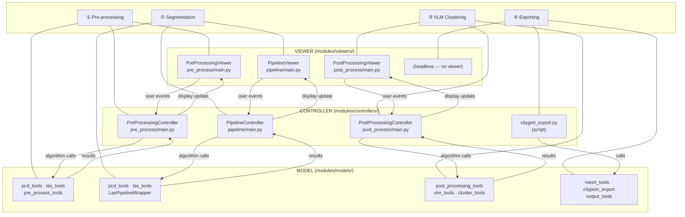

# Figure 1 — High-level MVC Architecture Diagram

**Referenced in**: Section III-B  
**Type**: Block/layer diagram

## Recommended IEEE Format

**Diagram type**: Three-layer block diagram (TikZ)

Draw three horizontal bands labeled **View**, **Controller**, and **Model** from top to bottom. Inside each band, place four equally-spaced labeled rectangles — one per pipeline stage (Pre-processing, Segmentation, VLM Clustering, Exporting). Connect vertically aligned boxes across layers with bidirectional arrows labeled *"user events"* (View→Controller) and *"calls / results"* (Controller↔Model). Use a vertical stage label on the left margin (①–④) to group columns.

**LaTeX approach**: TikZ with `\tikzstyle{layer}` rectangles and `\draw[->]` connectors. Keep to black-and-white; distinguish bands with light gray fills (`fill=gray!10`). Fits in one column (~8 cm wide).

---

