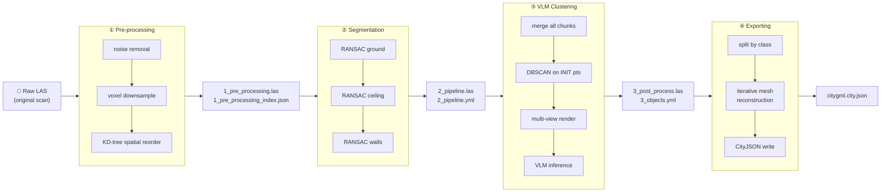

# Figure 2 — End-to-End Data Flow Diagram

**Referenced in**: Section III-C  
**Type**: Pipeline / data-flow diagram

## Recommended IEEE Format

**Diagram type**: Linear pipeline block diagram (TikZ)

Draw four rounded-rectangle stage boxes arranged left-to-right, connected by thick horizontal arrows. Label each arrow with the intermediate artifact filename (e.g., `1_pre_processing.las`). Below each stage box, add a small italicized sub-list of the two or three key operations. The raw input file sits left of stage ① and the final `citygml.city.json` sits right of stage ④.

**LaTeX approach**: TikZ `\node[draw, rounded corners, minimum width=2.2cm]` chain with `\draw[->, thick]` edges; artifact labels as `\node[font=\scriptsize\ttfamily]` above each arrow. Spans the full text width (two-column `figure*` environment).

---

