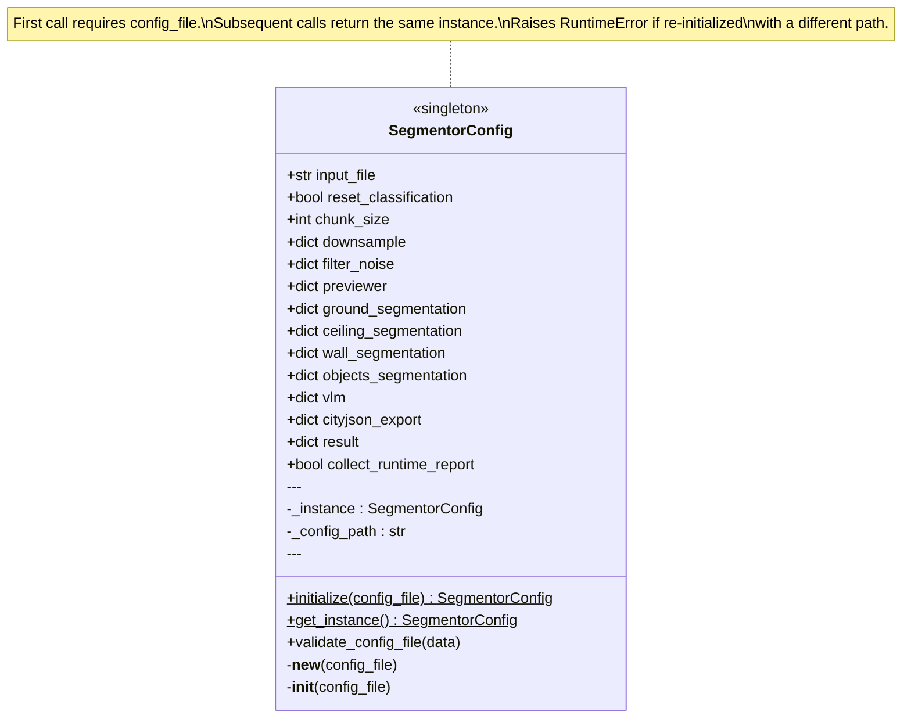

# Figure 3 — SegmentorConfig Singleton Class Diagram

**Referenced in**: Section III-D  
**Type**: UML class diagram

## Recommended IEEE Format

**Diagram type**: Simplified UML class box (TikZ or tabular)

Draw a single three-section box: top section = class name `SegmentorConfig` with `«singleton»` stereotype; middle section = key attributes (8–10, trimmed to the most architecturally significant); bottom section = public interface methods (`initialize`, `get_instance`, `validate_config_file`). Add a note balloon to the right explaining the `__new__` guard behavior.

**LaTeX approach**: TikZ with three `\node[draw, text width=5cm]` stacked vertically and a `\node[draw, callout rectangle]` note. Keep the attribute list to ≤10 lines to fit in one column. Alternatively use `\begin{tabular}{|l|}` with `\hline` separators — cleaner for IEEE reviewers who prefer plain tables.

---

