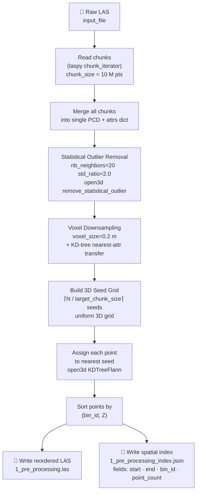

# Figure 4 — Pre-processing Stage Flow Diagram

**Referenced in**: Section III-E  
**Type**: Flowchart

## Recommended IEEE Format

**Diagram type**: Standard ANSI/ISO flowchart (TikZ)

Use the classic flowchart symbol set: parallelograms for file I/O (raw LAS input, `.las` output, `.json` output), rectangles for processing steps (noise removal, downsample, grid build, KD-tree assign, sort). The flow is strictly linear (top-to-bottom, no branches), so a single-column layout is clean and compact. Annotate each process box with its key parameter values in a smaller font.

**LaTeX approach**: TikZ `shapes.geometric` library — `\node[trapezium]` for I/O, `\node[rectangle,draw]` for processes, all connected by `\draw[->]`. Place parameter annotations as `\node[font=\scriptsize, right=0.1cm of ...]`. Fits comfortably in one column.

---

