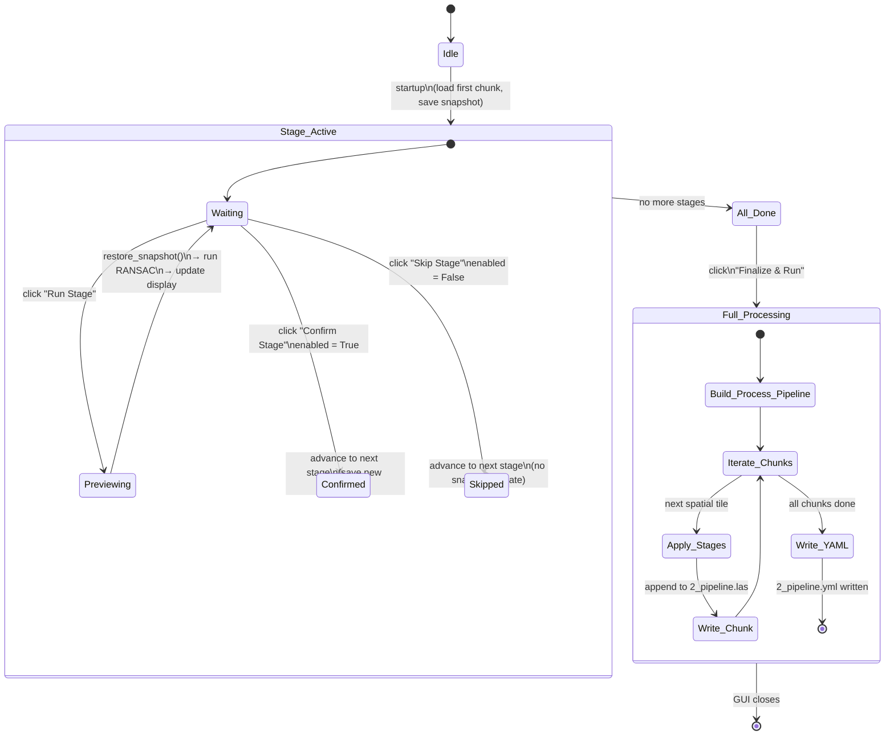

# Figure 5 — Segmentation Stage State Machine Diagram

**Referenced in**: Section III-F  
**Type**: State machine diagram

## Recommended IEEE Format

**Diagram type**: UML statechart / hierarchical FSM (TikZ `automata`)

Draw rounded rectangles for simple states (Idle, All\_Done) and a large outer rounded rectangle for the composite state `Stage_Active` containing its three inner states (Waiting, Previewing, Confirmed/Skipped). Add a second composite state `Full_Processing` with its own inner chain. Label all transition arcs with the triggering event (user click) and guard/action in a smaller font below. Use a filled circle for the initial pseudo-state and a circle-in-circle for the final pseudo-state.

**LaTeX approach**: TikZ `automata` library — `\node[state]`, `\node[state, accepting]`, `\node[draw, rounded corners, fit=...]` for composite states. Transition labels via `\path[->, bend left/right] ... node[sloped, font=\scriptsize]`. This figure is wide; prefer the two-column `figure*` environment.

---

