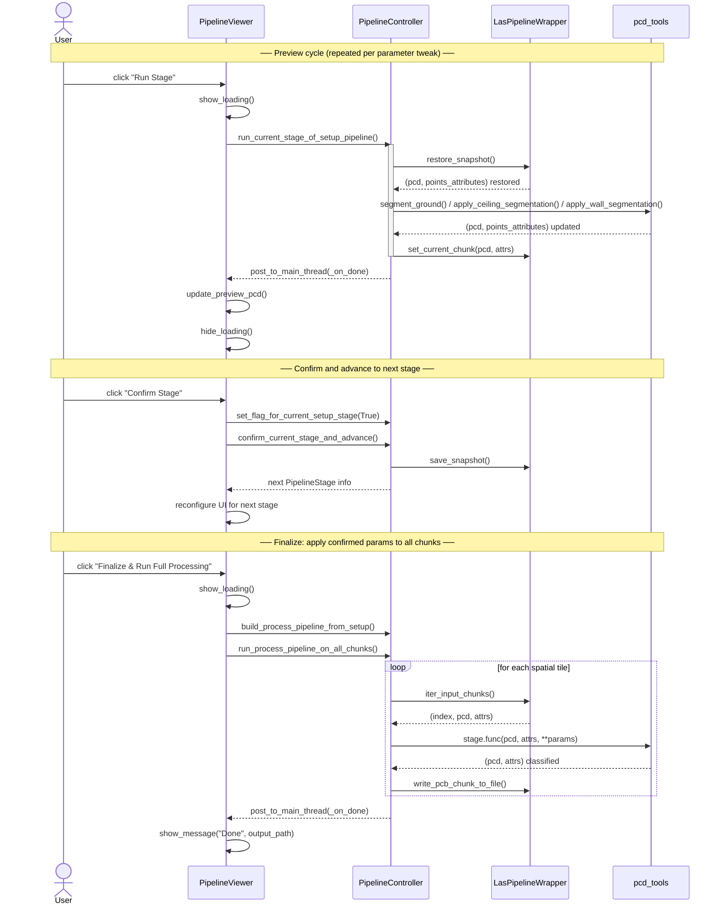

# Figure 6 — Sequence Diagram: "Run Stage" to "Finalize"

**Referenced in**: Section III-F.3  
**Type**: UML sequence diagram

## Recommended IEEE Format

**Diagram type**: UML sequence diagram (pgf-umlsd or TikZ manual)

Draw five vertical lifelines: *User*, *PipelineViewer*, *PipelineController*, *LasPipelineWrapper*, *pcd\_tools*. Group the interaction into three clearly labeled `Note` boxes spanning all lifelines: *Preview cycle*, *Confirm and advance*, *Finalize*. Use solid arrows for calls, dashed arrows for returns, and an activation box (thin rectangle) on each lifeline while it is executing. The `loop` frame around the per-chunk iteration in the Finalize section should be a standard UML combined fragment.

**LaTeX approach**: Use the `pgf-umlsd` package (`\begin{sequencediagram}`) which handles lifeline spacing automatically. Alternatively, draw manually in TikZ with `\draw[dashed]` lifelines and `\draw[->]` messages. Use `\begin{figure*}` (two-column span) — five lifelines are too wide for a single column.

---

