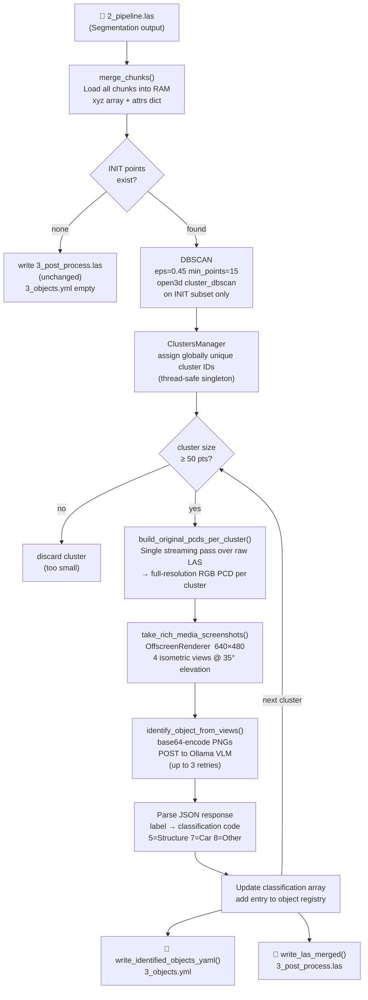

# Figure 7 — VLM Clustering Stage Pipeline Diagram

**Referenced in**: Section III-G  
**Type**: Flowchart

## Recommended IEEE Format

**Diagram type**: Flowchart with decision nodes and loop-back arrow (TikZ)

Draw a top-to-bottom flowchart. Use two diamond decision nodes: one for *"INIT points exist?"* (branch to early exit) and one for *"cluster ≥ 50 pts?"* (branch to discard). After the VLM classification step, draw a loop-back arrow from *"Update classification"* back up to the size-filter diamond labeled *"next cluster"*, and a downward arrow out of the loop labeled *"all clusters done"*. Use parallelograms for the two file-output nodes at the bottom.

**LaTeX approach**: TikZ with `\node[diamond, aspect=2, draw]` for decisions, `\node[rectangle, draw]` for processes, `\node[trapezium, draw]` for file outputs. Route the loop-back arrow to the left side of the diagram with `\draw[->, rounded corners] ... -- ++(-2,0) -- ...`. Fits in one column with a narrow width.

---

