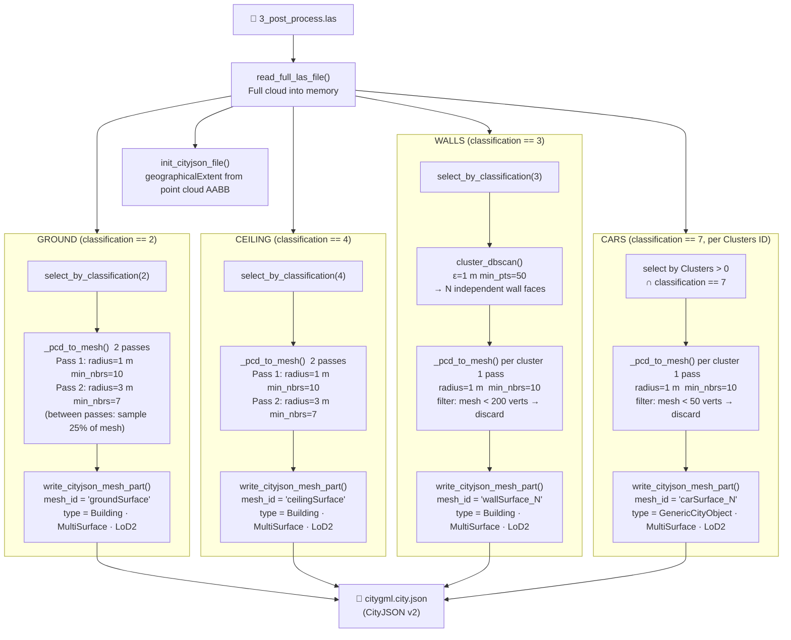

# Figure 8 — Exporting Stage Component Diagram

**Referenced in**: Section III-H  
**Type**: Component / data-flow diagram

## Recommended IEEE Format

**Diagram type**: Fan-out / fan-in block diagram (TikZ)

Draw a single input box (`3_post_process.las`) fanning out via four arrows to four parallel processing columns: **Ground**, **Ceiling**, **Walls**, **Cars**. Each column contains two or three stacked boxes (select → mesh → write). All four columns fan back in to a single output box (`citygml.city.json`). Below the diagram, include the iterative refinement schedule as a small companion `\begin{table}` (Pass / Radius / Min-neighbours). The parallel structure makes the independence of the four surface types visually obvious.

**LaTeX approach**: TikZ `\matrix` with one column per surface type; `\draw[->, thick]` fan-out from input and fan-in to output. Use `fill=gray!15` to shade each column's bounding box as a visual grouping. Span two columns (`figure*`) for readability.

---

### Iterative mesh refinement schedule

| Pass | Ball radius (m) | Min neighbours | Input cloud |
|:---:|:---:|:---:|---|
| 1 | 1 | 10 | original classified PCD |
| 2 | 3 | 7 | 25% uniform sample of pass-1 mesh |
| 3 | 5 | 4 | 25% uniform sample of pass-2 mesh |
| 4 | 6 | 2 | 25% uniform sample of pass-3 mesh |
| 5 | 9 | 1 | 25% uniform sample of pass-4 mesh |

Ground and ceiling use 2 passes by default. Walls and cars use 1 pass.
