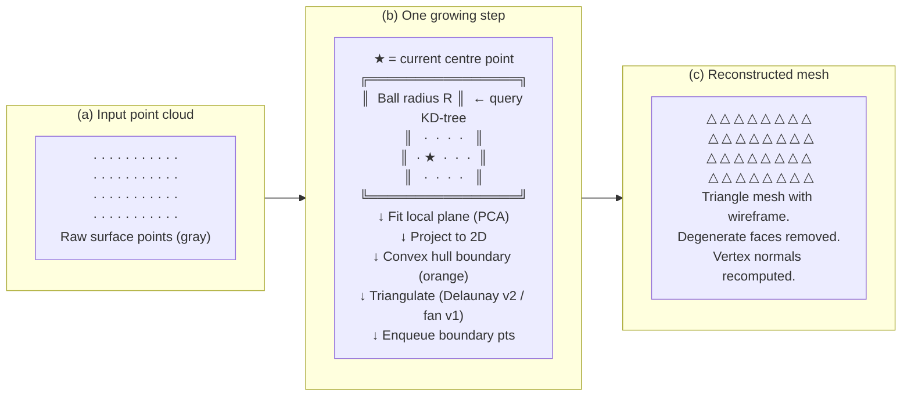

# Figure 12 — Ball-Neighbourhood Mesh Reconstruction Steps

**Referenced in**: Section IV-D  
**Type**: Three-panel conceptual diagram

## Recommended IEEE Format

**Diagram type**: Three-panel `\subfloat` figure (TikZ schematic or mesh renders)

Present three panels: **(a)** a scatter of gray dots representing the raw point cloud; **(b)** a close-up of one growing step showing the ball circle, the centre point star, the projected convex hull boundary in a contrasting color, and the resulting triangle fan; **(c)** the completed wireframe mesh over the original points. If actual render screenshots are available, use those — they are more convincing than schematic drawings. Place the v1 vs v2 algorithm comparison as a companion `\begin{table}` directly below the figure rather than inside it.

**LaTeX approach**: For the schematic option, draw panels (a)–(c) in TikZ using `\fill[gray!40] (x,y) circle (1.5pt)` for point dots, `\draw[orange, thick]` for the convex hull, and `\draw[blue!60, thin]` for triangle edges. Use `\subfloat` with `width=0.32\linewidth` each. Fits in one column.

---

### Algorithm comparison: v1 vs v2

| Step | v1 (used in Segmentation stage) | v2 (used in Exporting stage) |
|---|---|---|
| Triangulation | Fan triangulation from vertex 0 | Delaunay triangulation of boundary vertices |
| Interior fill | Partial (only boundary ring) | Full fill with centroid-in-polygon filter |
| Robustness | Fast, simple | More uniform, fewer degenerate triangles |
| File | `ball_neighbourhood_mesh.py` | `ball_neighbourhood_mesh_v2.py` |
